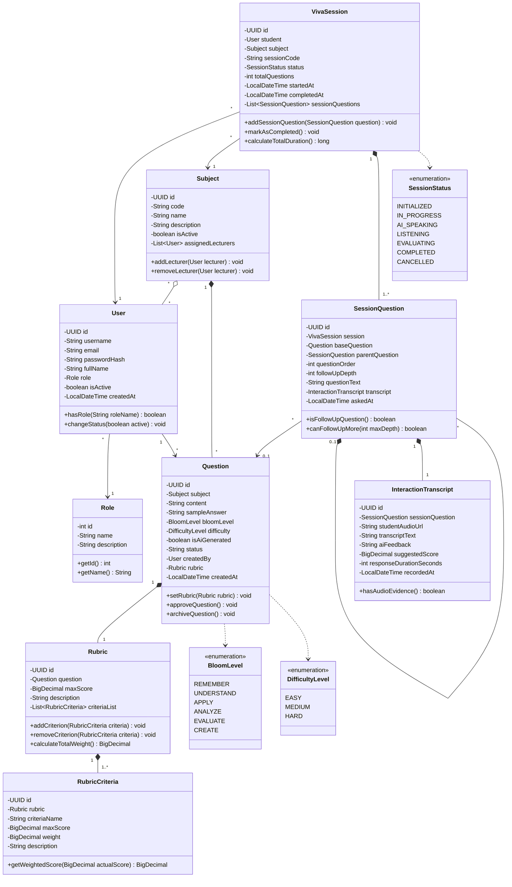

# TÀI LIỆU THIẾT KẾ CLASS DIAGRAM - HỆ THỐNG AIVES
> **Môn học:** SWD392 - Software Architecture & Design  
> **Phạm vi triển khai:** Nhóm 1 (Ngân hàng câu hỏi & Rubric), Nhóm 3 (Lõi phỏng vấn AI Viva), Nhóm 7 (Quản trị hệ thống)

---

## 1. TỔNG QUAN THIẾT KẾ CLASS DIAGRAM

Trong đồ án Kiến trúc Phần mềm (SWD392), Class Diagram chuẩn được chia thành **2 góc nhìn cốt lõi**:
1. **Domain Model Class Diagram (Mô hình Lớp Thực thể Nghiệp vụ):** Tập trung vào cấu trúc dữ liệu, các quan hệ OOP (Composition, Aggregation, Association) giữa các thực thể cốt lõi trong hệ thống.
2. **Layered Architecture Class Diagram (Mô hình Phân tầng Kiến trúc Spring Boot):** Thể hiện sự tách biệt giữa Controller, Service Interface, Service Implementation, Repository, Entity và DTO theo nguyên lý **SOLID (đặc biệt là Dependency Inversion)**.

---

## 2. DOMAIN MODEL CLASS DIAGRAM (SƠ ĐỒ LỚP THỰC THỂ NGHIỆP VỤ)

Sơ đồ này mô tả cấu trúc các Entity trong hệ thống cùng các mối quan hệ cấu thành (Composition) và liên kết (Association).

---

## 3. LAYERED ARCHITECTURE CLASS DIAGRAM (SPRING BOOT)

Mô hình phân tầng thể hiện chuẩn mực thiết kế:
- **Presentation Layer (Controllers):** Tiếp nhận HTTP Request.
- **Service Layer (Interfaces & Implementations):** Xử lý nghiệp vụ & thuật toán AI.
- **Data Access Layer (Spring Data JPA Repositories):** Giao tiếp CSDL.
- **Data Transfer Objects (DTOs):** Trao đổi thông tin giữa Client và Server.

```mermaid
classDiagram
    direction TB

    %% REST Controllers
    class QuestionController {
        -QuestionService questionService
        +createQuestion(QuestionCreateRequest request) ResponseEntity~ApiResponse~QuestionResponse~~
        +getQuestionById(UUID id) ResponseEntity~ApiResponse~QuestionResponse~~
        +getQuestions(UUID subjectId, BloomLevel bloomLevel, Pageable pageable) ResponseEntity~ApiResponse~Page~QuestionResponse~~~
        +updateQuestion(UUID id, QuestionCreateRequest request) ResponseEntity~ApiResponse~QuestionResponse~~
        +deleteQuestion(UUID id) ResponseEntity~ApiResponse~Void~~
    }

    class VivaExamController {
        -VivaExamService vivaExamService
        +startSession(VivaStartRequest request) ResponseEntity~ApiResponse~VivaSessionResponse~~
        +submitAnswer(UUID sessionId, AnswerSubmitRequest request) ResponseEntity~ApiResponse~FollowUpEvaluationResponse~~
        +finishSession(UUID sessionId) ResponseEntity~ApiResponse~VivaSummaryResponse~~
    }

    class AdminConfigController {
        -SystemConfigService configService
        +getAllConfigs() ResponseEntity~ApiResponse~List~SystemConfigResponse~~~
        +updateConfig(String key, ConfigUpdateRequest request) ResponseEntity~ApiResponse~SystemConfigResponse~~
    }

    %% Service Interfaces
    class QuestionService {
        <<interface>>
        +createQuestion(QuestionCreateRequest request) QuestionResponse
        +getQuestionById(UUID id) QuestionResponse
        +getQuestions(UUID subjectId, BloomLevel bloomLevel, Pageable pageable) Page~QuestionResponse~
        +updateQuestion(UUID id, QuestionCreateRequest request) QuestionResponse
        +deleteQuestion(UUID id) void
    }

    class VivaExamService {
        <<interface>>
        +initSession(UUID studentId, UUID subjectId) VivaSessionResponse
        +processStudentAnswer(UUID sessionQuestionId, AnswerSubmitRequest request) FollowUpEvaluationResponse
        +concludeSession(UUID sessionId) VivaSummaryResponse
    }

    class AiInterviewCoreService {
        <<interface>>
        +speechToText(byte[] audioData) String
        +textToSpeech(String textPrompt) byte[]
        +evaluateAndDecideFollowUp(String mainQuestion, String rubricSummary, String studentAnswer, int currentDepth) FollowUpDecisionDto
    }

    class SystemConfigService {
        <<interface>>
        +getIntConfig(String key, int defaultValue) int
        +getStringConfig(String key, String defaultValue) String
        +updateConfig(String key, String value) void
    }

    %% Service Implementations
    class QuestionServiceImpl {
        -QuestionRepository questionRepository
        -SubjectRepository subjectRepository
        +createQuestion(QuestionCreateRequest request) QuestionResponse
        -validateRubricWeights(List~RubricCriteriaRequest~ criteriaList) void
        -mapToQuestionResponse(Question question) QuestionResponse
    }

    class VivaExamServiceImpl {
        -VivaSessionRepository sessionRepository
        -SessionQuestionRepository sessionQuestionRepository
        -AiInterviewCoreService aiCoreService
        -SystemConfigService configService
        +initSession(UUID studentId, UUID subjectId) VivaSessionResponse
        +processStudentAnswer(UUID sessionQuestionId, AnswerSubmitRequest request) FollowUpEvaluationResponse
    }

    %% Repositories (DAO)
    class QuestionRepository {
        <<interface>>
        +findBySubjectIdAndStatus(UUID subjectId, String status, Pageable pageable) Page~Question~
        +findByIdWithFullRubric(UUID id) Optional~Question~
    }

    class VivaSessionRepository {
        <<interface>>
        +findByStudentIdAndStatus(UUID studentId, SessionStatus status) Optional~VivaSession~
        +findBySessionCode(String sessionCode) Optional~VivaSession~
    }

    class SessionQuestionRepository {
        <<interface>>
        +findBySessionIdOrderByQuestionOrderAsc(UUID sessionId) List~SessionQuestion~
        +countByParentQuestionId(UUID parentQuestionId) int
    }

    %% DTOs
    class QuestionCreateRequest {
        -UUID subjectId
        -String content
        -String sampleAnswer
        -BloomLevel bloomLevel
        -DifficultyLevel difficulty
        -List~RubricCriteriaRequest~ criteriaList
    }

    class QuestionResponse {
        -UUID id
        -UUID subjectId
        -String content
        -BloomLevel bloomLevel
        -DifficultyLevel difficulty
        -RubricResponse rubric
    }

    class AnswerSubmitRequest {
        -UUID sessionQuestionId
        -String audioUrl
        -String transcriptText
        -int responseDurationSeconds
    }

    class FollowUpEvaluationResponse {
        -boolean isFollowUpRequired
        -int currentDepth
        -String nextQuestionText
        -String aiReasoningNote
    }

    %% Inversion of Control & Dependencies
    QuestionController ..> QuestionService
    VivaExamController ..> VivaExamService
    AdminConfigController ..> SystemConfigService

    QuestionServiceImpl ..|> QuestionService
    VivaExamServiceImpl ..|> VivaExamService

    VivaExamServiceImpl ..> AiInterviewCoreService
    VivaExamServiceImpl ..> SystemConfigService

    QuestionServiceImpl ..> QuestionRepository
    VivaExamServiceImpl ..> VivaSessionRepository
    VivaExamServiceImpl ..> SessionQuestionRepository

    QuestionController ..> QuestionCreateRequest
    QuestionController ..> QuestionResponse
    VivaExamController ..> AnswerSubmitRequest
    VivaExamController ..> FollowUpEvaluationResponse
```

---

## 4. BẢNG GIẢI THÍCH CHI TIẾT MỐI QUAN HỆ OOP (DÙNG ĐỂ BẢO VỆ ĐỒ ÁN)

| Mối quan hệ UML | Ký hiệu | Các lớp áp dụng | Bản chất lập trình & Lý do thiết kế |
| :--- | :---: | :--- | :--- |
| **Composition (Cấu thành mạnh)** | `*--` | `Question` $\rightarrow$ `Rubric` `Rubric` $\rightarrow$ `RubricCriteria` `SessionQuestion` $\rightarrow$ `InteractionTranscript` | - **Vòng đời phụ thuộc:** Khi xóa một `Question`, `Rubric` và các `RubricCriteria` đi kèm bắt buộc phải bị xóa theo (không thể tồn tại một Rubric mồ côi không gắn với câu hỏi nào). - Trong JPA: Áp dụng `cascade = CascadeType.ALL, orphanRemoval = true`. |
| **Aggregation (Tập hợp yếu)** | `o--` | `Subject` $\rightarrow$ `User` (Lecturer) | - Giảng viên được phân công phụ trách Môn học. Nếu xóa Môn học, tài khoản Giảng viên vẫn tồn tại trong hệ thống. |
| **Recursive Association (Quan hệ Tự liên kết Đệ quy)** | `*--` | `SessionQuestion` $\rightarrow$ `SessionQuestion` | - **Điểm sáng tạo nhất của đồ án:** Câu hỏi xoáy phụ (`follow-up question`) được sinh ra từ câu hỏi gốc hoặc câu hỏi xoáy cấp trước đó. Bằng cách trỏ `parent_question_id` về chính nó, hệ thống lưu được toàn bộ cây đối thoại phân nhánh của buổi thi. |
| **Dependency Inversion (DIP)** | `..|>` | `QuestionServiceImpl` $\rightarrow$ `QuestionService` | - Tầng Controller không phụ thuộc trực tiếp vào lớp triển khai cụ thể (`ServiceImpl`) mà chỉ phụ thuộc vào `Interface`. Giúp hệ thống dễ viết Unit Test (Mocking) và dễ dàng thay thế logic khi cần. |
