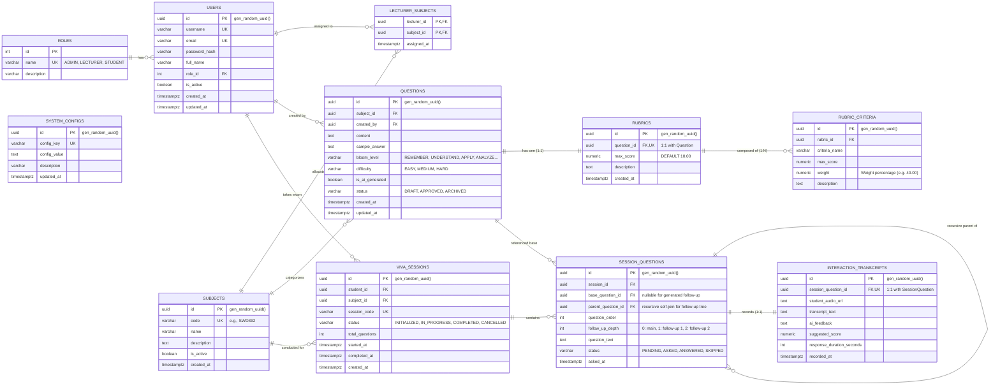

# TÀI LIỆU THIẾT KẾ CƠ SỞ DỮ LIỆU VẬT LÝ (PHYSICAL ERD) - AIVES
> **Hệ quản trị CSDL:** PostgreSQL 15+  
> **Môn học:** SWD392 - Software Architecture & Design  
> **Phạm vi triển khai:** Nhóm 1 (Ngân hàng câu hỏi & Rubric), Nhóm 3 (Lõi thi AI Viva), Nhóm 7 (Quản trị hệ thống)

---

## 1. SƠ ĐỒ THỰC THỂ LIÊN KẾT VẬT LÝ (PHYSICAL ERD - MERMAID)



---

## 2. BẢNG ĐẶC TẢ CHI TIẾT TỪNG BẢNG DỮ LIỆU

### Nhóm 7: Quản trị Hệ thống & Phân quyền (Administration & Security)

#### 1. Bảng `roles` (Vai trò người dùng)
| Tên cột | Kiểu dữ liệu | Ràng buộc | Diễn giải |
| :--- | :--- | :--- | :--- |
| `id` | `INT` | `PK, GENERATED ALWAYS AS IDENTITY` | Khóa chính tự tăng |
| `name` | `VARCHAR(50)` | `NOT NULL, UNIQUE` | Tên vai trò: `ADMIN`, `LECTURER`, `STUDENT` |
| `description` | `VARCHAR(255)` | `NULLABLE` | Mô tả trách nhiệm quyền hạn |

#### 2. Bảng `users` (Tài khoản người dùng)
| Tên cột | Kiểu dữ liệu | Ràng buộc | Diễn giải |
| :--- | :--- | :--- | :--- |
| `id` | `UUID` | `PK, DEFAULT gen_random_uuid()` | Khóa chính UUID |
| `username` | `VARCHAR(100)` | `NOT NULL, UNIQUE` | Tên đăng nhập |
| `email` | `VARCHAR(255)` | `NOT NULL, UNIQUE` | Địa chỉ email người dùng |
| `password_hash` | `VARCHAR(255)`| `NOT NULL` | Chuỗi mật khẩu đã băm BCrypt |
| `full_name` | `VARCHAR(150)` | `NOT NULL` | Họ và tên hiển thị |
| `role_id` | `INT` | `NOT NULL, FK -> roles(id)` | Khóa ngoại xác định vai trò |
| `is_active` | `BOOLEAN` | `NOT NULL, DEFAULT TRUE` | Trạng thái kích hoạt tài khoản |
| `created_at` | `TIMESTAMPTZ` | `NOT NULL, DEFAULT NOW()` | Thời gian tạo tài khoản |
| `updated_at` | `TIMESTAMPTZ` | `NOT NULL, DEFAULT NOW()` | Thời gian cập nhật gần nhất |

#### 3. Bảng `subjects` (Môn học)
| Tên cột | Kiểu dữ liệu | Ràng buộc | Diễn giải |
| :--- | :--- | :--- | :--- |
| `id` | `UUID` | `PK, DEFAULT gen_random_uuid()` | Khóa chính môn học |
| `code` | `VARCHAR(50)` | `NOT NULL, UNIQUE` | Mã môn học (ví dụ: `SWD392`, `PRN211`) |
| `name` | `VARCHAR(255)` | `NOT NULL` | Tên đầy đủ môn học |
| `description` | `TEXT` | `NULLABLE` | Đề cương/mô tả môn học |
| `is_active` | `BOOLEAN` | `NOT NULL, DEFAULT TRUE` | Trạng thái mở thi vấn đáp |
| `created_at` | `TIMESTAMPTZ` | `NOT NULL, DEFAULT NOW()` | Thời gian tạo môn |

#### 4. Bảng `lecturer_subjects` (Phân công Giảng viên - Môn học)
| Tên cột | Kiểu dữ liệu | Ràng buộc | Diễn giải |
| :--- | :--- | :--- | :--- |
| `lecturer_id` | `UUID` | `PK, FK -> users(id) ON DELETE CASCADE` | Khóa chính phức hợp 1 |
| `subject_id` | `UUID` | `PK, FK -> subjects(id) ON DELETE CASCADE`| Khóa chính phức hợp 2 |
| `assigned_at` | `TIMESTAMPTZ` | `NOT NULL, DEFAULT NOW()` | Thời điểm phân công |

#### 5. Bảng `system_configs` (Cấu hình tham số hệ thống & AI)
| Tên cột | Kiểu dữ liệu | Ràng buộc | Diễn giải |
| :--- | :--- | :--- | :--- |
| `id` | `UUID` | `PK, DEFAULT gen_random_uuid()` | Khóa chính cấu hình |
| `config_key` | `VARCHAR(100)`| `NOT NULL, UNIQUE` | Khóa định danh tham số (ví dụ: `AI_TTS_VOICE`, `MAX_FOLLOW_UP_DEPTH`) |
| `config_value`| `TEXT` | `NOT NULL` | Giá trị tham số |
| `description` | `VARCHAR(255)`| `NULLABLE` | Ý nghĩa của cấu hình |
| `updated_at` | `TIMESTAMPTZ` | `NOT NULL, DEFAULT NOW()` | Thời điểm điều chỉnh gần nhất |

---

### Nhóm 1: Ngân hàng Câu hỏi & Rubric (Question Bank & Rubric)

#### 6. Bảng `questions` (Ngân hàng câu hỏi)
| Tên cột | Kiểu dữ liệu | Ràng buộc | Diễn giải |
| :--- | :--- | :--- | :--- |
| `id` | `UUID` | `PK, DEFAULT gen_random_uuid()` | Khóa chính câu hỏi |
| `subject_id` | `UUID` | `NOT NULL, FK -> subjects(id) ON DELETE RESTRICT` | Thuộc môn học nào |
| `created_by` | `UUID` | `NOT NULL, FK -> users(id)` | Giảng viên tạo câu hỏi |
| `content` | `TEXT` | `NOT NULL` | Nội dung câu hỏi vấn đáp |
| `sample_answer`| `TEXT` | `NULLABLE` | Gợi ý câu trả lời chuẩn |
| `bloom_level` | `VARCHAR(30)` | `NOT NULL, CHECK IN ('REMEMBER', 'UNDERSTAND', 'APPLY', 'ANALYZE', 'EVALUATE', 'CREATE')` | Thang đo nhận thức Bloom |
| `difficulty` | `VARCHAR(20)` | `NOT NULL, CHECK IN ('EASY', 'MEDIUM', 'HARD')` | Mức độ khó của câu hỏi |
| `is_ai_generated`| `BOOLEAN` | `NOT NULL, DEFAULT FALSE` | Đánh dấu câu hỏi do AI/RAG sinh ra |
| `status` | `VARCHAR(30)` | `NOT NULL, DEFAULT 'APPROVED'` | Trạng thái: `DRAFT`, `APPROVED`, `ARCHIVED` |
| `created_at` | `TIMESTAMPTZ` | `NOT NULL, DEFAULT NOW()` | Ngày tạo |
| `updated_at` | `TIMESTAMPTZ` | `NOT NULL, DEFAULT NOW()` | Ngày cập nhật |

#### 7. Bảng `rubrics` (Ma trận đánh giá tổng thể)
| Tên cột | Kiểu dữ liệu | Ràng buộc | Diễn giải |
| :--- | :--- | :--- | :--- |
| `id` | `UUID` | `PK, DEFAULT gen_random_uuid()` | Khóa chính Rubric |
| `question_id` | `UUID` | `NOT NULL, UNIQUE, FK -> questions(id) ON DELETE CASCADE` | Quan hệ 1:1 với câu hỏi |
| `max_score` | `NUMERIC(4,2)`| `NOT NULL, DEFAULT 10.00` | Thang điểm tối đa (thường là 10.0) |
| `description` | `TEXT` | `NULLABLE` | Hướng dẫn chấm tổng quát |
| `created_at` | `TIMESTAMPTZ` | `NOT NULL, DEFAULT NOW()` | Thời gian tạo |

#### 8. Bảng `rubric_criteria` (Tiêu chí chấm điểm cụ thể)
| Tên cột | Kiểu dữ liệu | Ràng buộc | Diễn giải |
| :--- | :--- | :--- | :--- |
| `id` | `UUID` | `PK, DEFAULT gen_random_uuid()` | Khóa chính tiêu chí |
| `rubric_id` | `UUID` | `NOT NULL, FK -> rubrics(id) ON DELETE CASCADE` | Thuộc Rubric nào (1:N) |
| `criteria_name`| `VARCHAR(255)`| `NOT NULL` | Tên tiêu chí đánh giá |
| `max_score` | `NUMERIC(4,2)`| `NOT NULL, CHECK (max_score > 0)` | Điểm trần của tiêu chí này |
| `weight` | `NUMERIC(5,2)`| `NOT NULL, CHECK (weight > 0 AND weight <= 100)` | Trọng số % (Tổng các tiêu chí = 100%) |
| `description` | `TEXT` | `NULLABLE` | Mô tả mức độ đạt yêu cầu |

---

### Nhóm 3: Lõi Phỏng vấn AI Viva (AI Viva Exam Core)

#### 9. Bảng `viva_sessions` (Phiên thi vấn đáp)
| Tên cột | Kiểu dữ liệu | Ràng buộc | Diễn giải |
| :--- | :--- | :--- | :--- |
| `id` | `UUID` | `PK, DEFAULT gen_random_uuid()` | Khóa chính phiên thi |
| `student_id` | `UUID` | `NOT NULL, FK -> users(id)` | Thí sinh tham gia |
| `subject_id` | `UUID` | `NOT NULL, FK -> subjects(id)` | Môn thi vấn đáp |
| `session_code`| `VARCHAR(64)` | `NOT NULL, UNIQUE` | Mã phiên thi (phục vụ kết nối bảo mật) |
| `status` | `VARCHAR(30)` | `NOT NULL, DEFAULT 'INITIALIZED'` | Trạng thái: `INITIALIZED`, `IN_PROGRESS`, `COMPLETED`, `CANCELLED` |
| `total_questions`| `INT` | `NOT NULL, DEFAULT 0` | Số lượng câu hỏi chính trong đề |
| `started_at` | `TIMESTAMPTZ` | `NULLABLE` | Thời điểm bắt đầu thi thực tế |
| `completed_at`| `TIMESTAMPTZ` | `NULLABLE` | Thời điểm kết thúc buổi thi |
| `created_at` | `TIMESTAMPTZ` | `NOT NULL, DEFAULT NOW()` | Thời điểm tạo phòng thi |

#### 10. Bảng `session_questions` (Câu hỏi trong phiên thi - Quản lý Cây Hỏi Xoáy)
| Tên cột | Kiểu dữ liệu | Ràng buộc | Diễn giải |
| :--- | :--- | :--- | :--- |
| `id` | `UUID` | `PK, DEFAULT gen_random_uuid()` | Khóa chính câu hỏi phiên thi |
| `session_id` | `UUID` | `NOT NULL, FK -> viva_sessions(id) ON DELETE CASCADE` | Thuộc phiên thi nào |
| `base_question_id`| `UUID` | `NULLABLE, FK -> questions(id) ON DELETE SET NULL` | Câu hỏi gốc lấy từ ngân hàng đề (null nếu là câu hỏi xoáy do AI tự sinh) |
| `parent_question_id`| `UUID` | `NULLABLE, FK -> session_questions(id) ON DELETE CASCADE` | **Khóa ngoại tự liên kết đệ quy**: Trỏ về câu hỏi cha sinh ra câu hỏi này |
| `question_order`| `INT` | `NOT NULL` | Thứ tự câu hỏi trong đề thi |
| `follow_up_depth`| `INT` | `NOT NULL, DEFAULT 0` | Độ sâu hỏi xoáy (0: câu chính, 1: hỏi xoáy cấp 1, 2: hỏi xoáy cấp 2) |
| `question_text`| `TEXT` | `NOT NULL` | Lời thoại câu hỏi AI đọc cho sinh viên |
| `status` | `VARCHAR(30)` | `NOT NULL, DEFAULT 'PENDING'` | Trạng thái: `PENDING`, `ASKED`, `ANSWERED`, `SKIPPED` |
| `asked_at` | `TIMESTAMPTZ` | `NOT NULL, DEFAULT NOW()` | Thời điểm AI cất giọng đọc câu hỏi |

#### 11. Bảng `interaction_transcripts` (Lưu vết Lời thoại & Bằng chứng buổi thi)
| Tên cột | Kiểu dữ liệu | Ràng buộc | Diễn giải |
| :--- | :--- | :--- | :--- |
| `id` | `UUID` | `PK, DEFAULT gen_random_uuid()` | Khóa chính bản ghi transcript |
| `session_question_id`| `UUID` | `NOT NULL, UNIQUE, FK -> session_questions(id) ON DELETE CASCADE` | Quan hệ 1:1 với câu hỏi phiên thi |
| `student_audio_url`| `TEXT` | `NULLABLE` | Đường dẫn file ghi âm giọng nói của sinh viên (S3/Cloud Storage) |
| `transcript_text`| `TEXT` | `NOT NULL` | Văn bản đã chuyển đổi từ giọng nói (STT Result) |
| `ai_feedback` | `TEXT` | `NULLABLE` | Nhận xét phân tích của AI (lý do hỏi xoáy / điểm mạnh yếu) |
| `suggested_score`| `NUMERIC(4,2)`| `NULLABLE` | Điểm số gợi ý từ AI theo rubric |
| `response_duration_seconds`| `INT` | `NOT NULL, DEFAULT 0` | Thời gian sinh viên phát biểu (giây) |
| `recorded_at` | `TIMESTAMPTZ` | `NOT NULL, DEFAULT NOW()` | Thời điểm ghi nhận phản hồi |

---

## 3. FULL POSTGRESQL DDL SCRIPT (CHẠY TRỰC TIẾP TRÊN DBeaver / pgAdmin)

Bạn có thể copy đoạn mã SQL bên dưới và thực thi trên PostgreSQL để khởi tạo toàn bộ CSDL kèm Indexes tối ưu hiệu năng:

```sql
-- Kích hoạt extension sinh UUID tự động
CREATE EXTENSION IF NOT EXISTS "pgcrypto";

-- ========================================================
-- PHÂN HỆ 7: QUẢN TRỊ HỆ THỐNG & PHÂN QUYỀN
-- ========================================================

CREATE TABLE roles (
    id INT GENERATED ALWAYS AS IDENTITY PRIMARY KEY,
    name VARCHAR(50) NOT NULL UNIQUE,
    description VARCHAR(255)
);

-- Khởi tạo 3 vai trò mặc định
INSERT INTO roles (name, description) VALUES 
('ADMIN', 'Quản trị viên toàn hệ thống'),
('LECTURER', 'Giảng viên phụ trách môn học và câu hỏi'),
('STUDENT', 'Thí sinh tham gia thi vấn đáp AI');

CREATE TABLE users (
    id UUID PRIMARY KEY DEFAULT gen_random_uuid(),
    username VARCHAR(100) NOT NULL UNIQUE,
    email VARCHAR(255) NOT NULL UNIQUE,
    password_hash VARCHAR(255) NOT NULL,
    full_name VARCHAR(150) NOT NULL,
    role_id INT NOT NULL REFERENCES roles(id),
    is_active BOOLEAN NOT NULL DEFAULT TRUE,
    created_at TIMESTAMPTZ NOT NULL DEFAULT CURRENT_TIMESTAMP,
    updated_at TIMESTAMPTZ NOT NULL DEFAULT CURRENT_TIMESTAMP
);

CREATE TABLE subjects (
    id UUID PRIMARY KEY DEFAULT gen_random_uuid(),
    code VARCHAR(50) NOT NULL UNIQUE,
    name VARCHAR(255) NOT NULL,
    description TEXT,
    is_active BOOLEAN NOT NULL DEFAULT TRUE,
    created_at TIMESTAMPTZ NOT NULL DEFAULT CURRENT_TIMESTAMP
);

CREATE TABLE lecturer_subjects (
    lecturer_id UUID NOT NULL REFERENCES users(id) ON DELETE CASCADE,
    subject_id UUID NOT NULL REFERENCES subjects(id) ON DELETE CASCADE,
    assigned_at TIMESTAMPTZ NOT NULL DEFAULT CURRENT_TIMESTAMP,
    PRIMARY KEY (lecturer_id, subject_id)
);

CREATE TABLE system_configs (
    id UUID PRIMARY KEY DEFAULT gen_random_uuid(),
    config_key VARCHAR(100) NOT NULL UNIQUE,
    config_value TEXT NOT NULL,
    description VARCHAR(255),
    updated_at TIMESTAMPTZ NOT NULL DEFAULT CURRENT_TIMESTAMP
);

-- Cấu hình tham số mặc định
INSERT INTO system_configs (config_key, config_value, description) VALUES
('AI_TTS_VOICE', 'vi-VN-Neural2-A', 'Giọng đọc AI mặc định'),
('AI_STT_PROVIDER', 'GOOGLE_CHIRP', 'Bộ nhận diện giọng nói tiếng Việt'),
('MAX_FOLLOW_UP_DEPTH', '2', 'Số lần hỏi xoáy tối đa mỗi câu hỏi'),
('ANSWER_TIME_LIMIT_SEC', '90', 'Thời gian trả lời tối đa mỗi câu (giây)');

-- ========================================================
-- PHÂN HỆ 1: NGÂN HÀNG CÂU HỎI & RUBRIC
-- ========================================================

CREATE TABLE questions (
    id UUID PRIMARY KEY DEFAULT gen_random_uuid(),
    subject_id UUID NOT NULL REFERENCES subjects(id) ON DELETE RESTRICT,
    created_by UUID NOT NULL REFERENCES users(id),
    content TEXT NOT NULL,
    sample_answer TEXT,
    bloom_level VARCHAR(30) NOT NULL CHECK (bloom_level IN ('REMEMBER', 'UNDERSTAND', 'APPLY', 'ANALYZE', 'EVALUATE', 'CREATE')),
    difficulty VARCHAR(20) NOT NULL CHECK (difficulty IN ('EASY', 'MEDIUM', 'HARD')),
    is_ai_generated BOOLEAN NOT NULL DEFAULT FALSE,
    status VARCHAR(30) NOT NULL DEFAULT 'APPROVED' CHECK (status IN ('DRAFT', 'APPROVED', 'ARCHIVED')),
    created_at TIMESTAMPTZ NOT NULL DEFAULT CURRENT_TIMESTAMP,
    updated_at TIMESTAMPTZ NOT NULL DEFAULT CURRENT_TIMESTAMP
);

CREATE TABLE rubrics (
    id UUID PRIMARY KEY DEFAULT gen_random_uuid(),
    question_id UUID NOT NULL UNIQUE REFERENCES questions(id) ON DELETE CASCADE,
    max_score NUMERIC(4, 2) NOT NULL DEFAULT 10.00,
    description TEXT,
    created_at TIMESTAMPTZ NOT NULL DEFAULT CURRENT_TIMESTAMP
);

CREATE TABLE rubric_criteria (
    id UUID PRIMARY KEY DEFAULT gen_random_uuid(),
    rubric_id UUID NOT NULL REFERENCES rubrics(id) ON DELETE CASCADE,
    criteria_name VARCHAR(255) NOT NULL,
    max_score NUMERIC(4, 2) NOT NULL CHECK (max_score > 0),
    weight NUMERIC(5, 2) NOT NULL CHECK (weight > 0 AND weight <= 100),
    description TEXT
);

-- ========================================================
-- PHÂN HỆ 3: LÕI PHỎNG VẤN AI VIVA
-- ========================================================

CREATE TABLE viva_sessions (
    id UUID PRIMARY KEY DEFAULT gen_random_uuid(),
    student_id UUID NOT NULL REFERENCES users(id),
    subject_id UUID NOT NULL REFERENCES subjects(id),
    session_code VARCHAR(64) NOT NULL UNIQUE,
    status VARCHAR(30) NOT NULL DEFAULT 'INITIALIZED' CHECK (status IN ('INITIALIZED', 'IN_PROGRESS', 'COMPLETED', 'CANCELLED')),
    total_questions INT NOT NULL DEFAULT 0,
    started_at TIMESTAMPTZ,
    completed_at TIMESTAMPTZ,
    created_at TIMESTAMPTZ NOT NULL DEFAULT CURRENT_TIMESTAMP
);

CREATE TABLE session_questions (
    id UUID PRIMARY KEY DEFAULT gen_random_uuid(),
    session_id UUID NOT NULL REFERENCES viva_sessions(id) ON DELETE CASCADE,
    base_question_id UUID REFERENCES questions(id) ON DELETE SET NULL,
    parent_question_id UUID REFERENCES session_questions(id) ON DELETE CASCADE, -- Khóa ngoại đệ quy
    question_order INT NOT NULL,
    follow_up_depth INT NOT NULL DEFAULT 0,
    question_text TEXT NOT NULL,
    status VARCHAR(30) NOT NULL DEFAULT 'PENDING' CHECK (status IN ('PENDING', 'ASKED', 'ANSWERED', 'SKIPPED')),
    asked_at TIMESTAMPTZ NOT NULL DEFAULT CURRENT_TIMESTAMP
);

CREATE TABLE interaction_transcripts (
    id UUID PRIMARY KEY DEFAULT gen_random_uuid(),
    session_question_id UUID NOT NULL UNIQUE REFERENCES session_questions(id) ON DELETE CASCADE,
    student_audio_url TEXT,
    transcript_text TEXT NOT NULL,
    ai_feedback TEXT,
    suggested_score NUMERIC(4, 2),
    response_duration_seconds INT NOT NULL DEFAULT 0,
    recorded_at TIMESTAMPTZ NOT NULL DEFAULT CURRENT_TIMESTAMP
);

-- ========================================================
-- CHỈ MỤC TỐI ƯU HIỆU NĂNG (INDEXING STRATEGY)
-- ========================================================

CREATE INDEX idx_users_role ON users(role_id);
CREATE INDEX idx_questions_subject_bloom ON questions(subject_id, bloom_level, status);
CREATE INDEX idx_rubric_criteria_rubric ON rubric_criteria(rubric_id);
CREATE INDEX idx_sessions_student_status ON viva_sessions(student_id, status);
CREATE INDEX idx_session_questions_session_order ON session_questions(session_id, question_order);
CREATE INDEX idx_session_questions_parent ON session_questions(parent_question_id);
```

---

## 4. CÁC ĐIỂM KIẾN TRÚC "ĐẮT GIÁ" ĐỂ THUYẾT MINH BẢO VỆ ĐỒ ÁN

1. **Khóa ngoại tự liên kết đệ quy (`parent_question_id` trong `session_questions`):**
   * *Ý nghĩa:* Cho phép biểu diễn cây đối thoại dạng phân nhánh. Câu hỏi chính có `follow_up_depth = 0`, khi AI hỏi xoáy cấp 1 thì `parent_question_id` trỏ vào câu chính, hỏi xoáy cấp 2 trỏ vào câu cấp 1. Cấu trúc này mở rộng vô hạn cấp độ mà không cần tạo thêm bảng.
2. **Tại sao dùng kiểu dữ liệu `NUMERIC(4, 2)` thay vì `FLOAT`/`DOUBLE`?**
   * *Ý nghĩa:* Điểm số học tập và trọng số Rubric đòi hỏi độ chính xác tuyệt đối. Kiểu số thực (`FLOAT`/`DOUBLE`) bị sai số làm tròn số dấu phẩy động (Floating Point Precision Issue). `NUMERIC` lưu trữ chính xác giá trị thập phân.
3. **Chiến lược Ràng buộc Xóa (Cascade vs Restrict):**
   * Xóa một `Question` $\rightarrow$ Tự động xóa `Rubric` và `RubricCriteria` (`ON DELETE CASCADE`).
   * Xóa một `Subject` $\rightarrow$ Ngăn chặn nếu đang có câu hỏi thuộc môn này (`ON DELETE RESTRICT`) để bảo vệ toàn vẹn dữ liệu học tập.
