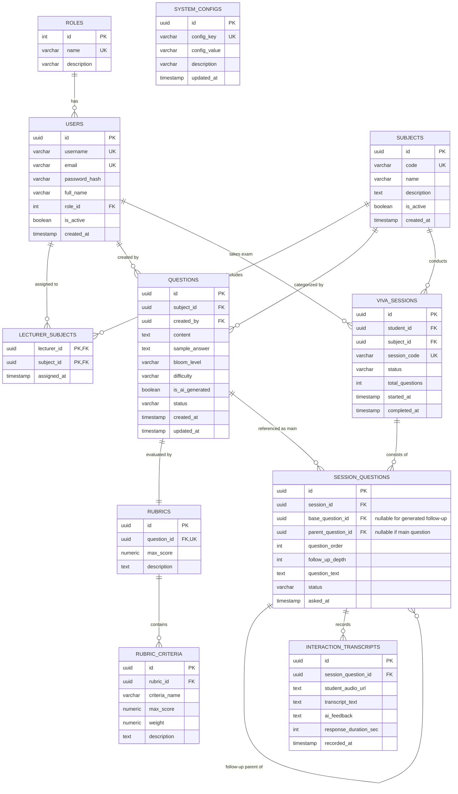

# TÀI LIỆU THIẾT KẾ HỆ THỐNG THI VẤN ĐÁP THÔNG MINH SỬ DỤNG AI (AIVES)
> **Môn học:** SWD392 - Software Architecture & Design  
> **Phạm vi triển khai:** Nhóm 1 (Ngân hàng câu hỏi & Rubric), Nhóm 3 (Lõi phỏng vấn AI Viva), Nhóm 7 (Quản trị hệ thống)

---

## 1. TỔNG QUAN PHẠM VI HỆ THỐNG (SCOPE DEFINITION)

Hệ thống tập trung giải quyết bài toán cốt lõi: Tự động hóa và chuẩn hóa buổi thi vấn đáp bằng AI có khả năng tương tác thoại 2 chiều và hỏi xoáy thích ứng (adaptive follow-up).

```
+-------------------------------------------------------------------------------+
|                      AIVES SYSTEM ARCHITECTURE OVERVIEW                      |
+-------------------------------------------------------------------------------+
|                                                                               |
|  [Nhóm 7: Quản trị Hệ thống]                                                 |
|   - Quản lý User (Admin, Lecturer, Student) & Phân quyền RBAC                |
|   - Phân công Giảng viên - Môn học                                            |
|   - Cấu hình TTS/STT Engine, Ngôn ngữ, Giới hạn hỏi xoáy                     |
|                                                                               |
|  [Nhóm 1: Quản lý Ngân hàng Câu hỏi & Rubric]                                |
|   - CRUD Câu hỏi theo Môn học, Thang Bloom (Nhớ, Hiểu, Vận dụng, Phân tích)   |
|   - AI Assistant sinh câu hỏi gợi ý từ tài liệu môn học                      |
|   - Thiết lập Rubric chấm điểm (Tiêu chí, Thang điểm, Trọng số)              |
|                                                                               |
|  [Nhóm 3: Lõi phỏng vấn AI - Core Engine]                                    |
|   - Phòng thi ảo (Virtual Viva Room) với Voice Loop tương tác thời gian thực  |
|   - AI Text-to-Speech (Đọc câu hỏi) -> Sinh viên Voice Input                  |
|   - Speech-to-Text (Chuyển giọng nói thành văn bản)                          |
|   - Adaptive Follow-up: AI phân tích câu trả lời và tự động hỏi xoáy/làm rõ   |
|                                                                               |
+-------------------------------------------------------------------------------+
```

---

## 2. THIẾT KẾ UI/UX (UI/UX DESIGN & USER FLOWS)

### 2.1. Bản đồ điều hướng (Sitemap)
```
/ (Landing Page - Đăng nhập SSO/Credentials)
├── /admin (Nhóm 7)
│   ├── /users (Quản lý tài khoản: Thêm, sửa, khóa, gán quyền)
│   ├── /subjects (Quản lý môn học & Phân công giảng viên)
│   └── /settings (Cấu hình tham số AI: Speech Engine, Max Follow-up, Ngôn ngữ)
├── /lecturer (Nhóm 1)
│   ├── /question-bank (Danh sách câu hỏi theo môn/chủ đề, lọc theo Bloom)
│   ├── /question-bank/create (Tạo thủ công hoặc mở modal "AI Sinh câu hỏi")
│   └── /question-bank/:id/rubric (Thiết lập ma trận tiêu chí chấm điểm)
└── /student (Nhóm 3)
    ├── /viva-lobby (Kiểm tra Micro, Loa, Camera, xem quy chế thi)
    └── /viva-room/:sessionId (Phòng thi vấn đáp AI tương tác giọng nói)
```

### 2.2. Chi tiết màn hình cốt lõi

#### Màn hình 1: Quản lý Ngân hàng Câu hỏi & Rubric (Lecturer Dashboard)
* **Mục tiêu:** Giúp giảng viên tìm kiếm, phân loại câu hỏi theo mức độ nhận thức (Thang Bloom) và gán rubric tiêu chí đánh giá.
* **Layout Wireframe:**
```
+-----------------------------------------------------------------------------------+
| AIVES | Môn: Kiến trúc phần mềm (SWD392)             [GV. Nguyễn Văn A] [Đăng xuất] |
+-----------------------------------------------------------------------------------+
| [Bộ lọc Môn học v] [Thang Bloom v] [Độ khó v] [Tìm kiếm...]   [+ AI Sinh câu hỏi] |
|                                                               [+ Tạo thủ công]   |
+-----------------------------------------------------------------------------------+
| STT | Nội dung câu hỏi                  | Bloom      | Độ khó | Rubric | Hành động|
+-----+-----------------------------------+------------+--------+--------+----------+
| 01  | Trình bày sự khác biệt giữa...   | Phân tích  | Khó    | 3 tiêu | [Sửa][Xóa|
|     | Monolithic và Microservices?      |            |        | chí    | [Rubric] |
| 02  | Mục đích của tầng DTO là gì?      | Hiểu       | Dễ     | 2 tiêu | [Sửa][Xóa|
|     |                                   |            |        | chí    | [Rubric] |
+-----------------------------------------------------------------------------------+
| Modal: "Thiết lập Rubric cho câu hỏi"                                             |
| Tiêu chí 1: Nêu đúng định nghĩa (Trọng số 40% - Max: 4.0đ)                        |
| Tiêu chí 2: Phân tích ưu/nhược điểm (Trọng số 40% - Max: 4.0đ)                    |
| Tiêu chí 3: Cho ví dụ thực tế liên hệ (Trọng số 20% - Max: 2.0đ)                   |
|                                                     [+ Thêm tiêu chí] [Lưu Rubric]|
+-----------------------------------------------------------------------------------+
```

#### Màn hình 2: Phòng thi vấn đáp AI (Virtual AI Viva Room - Nhóm 3)
* **Mục tiêu:** Tạo cảm giác phòng thi chuyên nghiệp, tập trung cao độ, trực quan hóa trạng thái giọng nói của AI và thí sinh.
* **Layout Wireframe:**
```
+-----------------------------------------------------------------------------------+
| AIVES EXAM | Môn: SWD392 | Thí sinh: Trần Thị B (MSSV: SE170123)   [Thời gian: 12:45] |
+----------------------------------------------------+------------------------------+
|             KHU VỰC TƯƠNG TÁC GIỌNG NÓI AI         |      TRANSCRIPT & LOG THI    |
|                                                    |                              |
|   +--------------------------------------------+   | [10:02] AI Giám khảo:        |
|   |             [ AI EXAMINER AVATAR ]         |   | "Chào bạn, hãy phân tích ưu  |
|   |         (((( Sóng âm Waveform ))))         |   | và nhược điểm của Event-     |
|   |   Trạng thái: [AI ĐANG ĐỌC CÂU HỎI...]     |   | driven Architecture?"        |
|   +--------------------------------------------+   |                              |
|                                                    | [10:03] Thí sinh trả lời:    |
|   Câu hỏi chính 02/05:                             | "Dạ thưa thầy cô, Event-     |
|   "Phân tích ưu & nhược điểm của Event-Driven?"    | driven giúp loose coupling,  |
|                                                    | mở rộng tốt qua RabbitMQ..." |
|   +--------------------------------------------+   |                              |
|   |  Cảnh báo: Hỏi xoáy vòng 1/2 (Deep-dive)   |   | [10:04] AI Hỏi xoáy (Vòng 1):|
|   |  "Bạn hãy nói rõ hơn về vấn đề Data        |   | "Nếu RabbitMQ bị sập thì hệ  |
|   |   Consistency khi dùng Event-Driven?"      |   | thống đảm bảo tính toàn vẹn  |
|   +--------------------------------------------+   | dữ liệu như thế nào?"        |
|                                                    |                              |
|   [ Bộ đếm trả lời: 00:45s ]                       |                              |
|   [ (•) Micro đang bật - Nói để trả lời... ]       |                              |
|   [ Nút: Đã trả lời xong (Gửi phản hồi) ]          |                              |
+----------------------------------------------------+------------------------------+
```

#### Màn hình 3: Quản trị Hệ thống (Admin Management - Nhóm 7)
* **Mục tiêu:** Quản lý tập trung người dùng, phân vai trò, gán giảng viên quản lý môn học và cấu hình thông số kỹ thuật cho AI.
* **Layout Wireframe:**
```
+-----------------------------------------------------------------------------------+
| AIVES ADMIN | [Người dùng] [Môn học & Phân công] [Cấu hình AI Voice] [Admin Root] |
+-----------------------------------------------------------------------------------+
| CẤU HÌNH THAM SỐ AI INTERVIEW                                                     |
| - Ngôn ngữ mặc định (Locale):         [ vi-VN (Tiếng Việt)         v ]            |
| - Text-To-Speech (TTS) Voice:         [ vi-VN-Neural2-A (Nữ miền Bắc) v ]          |
| - Speech-To-Text (STT) Model:         [ Google Chirp / Whisper Large v ]          |
| - Số lượt hỏi xoáy tối đa / câu hỏi:  [ 2 lượt                     v ]            |
| - Thời gian trả lời tối đa mỗi câu:   [ 90 giây                    v ]            |
| - Nhiệt độ AI (Creativity Temperature): [ 0.3 (Chính xác, nhất quán) v ]         |
|                                                      [Đặt lại mặc định] [Lưu lại]  |
+-----------------------------------------------------------------------------------+
```

---

## 3. THIẾT KẾ CƠ SỞ DỮ LIỆU VẬT LÝ (PHYSICAL ERD - POSTGRESQL)

### 3.1. Sơ đồ thực thể liên kết (Mermaid ERD)



### 3.2. Bảng mô tả chi tiết các trường dữ liệu (PostgreSQL Schema DDL notes)

1. **`users`**:
   - `id`: `UUID PRIMARY KEY DEFAULT gen_random_uuid()`
   - `role_id`: `INT NOT NULL REFERENCES roles(id)` (1: ADMIN, 2: LECTURER, 3: STUDENT)
   - `username`, `email`: `VARCHAR(100) UNIQUE NOT NULL`
   - `password_hash`: `VARCHAR(255) NOT NULL` (Mã hóa BCrypt)
2. **`questions`**:
   - `bloom_level`: `VARCHAR(30)` (`REMEMBER`, `UNDERSTAND`, `APPLY`, `ANALYZE`, `EVALUATE`, `CREATE`)
   - `difficulty`: `VARCHAR(20)` (`EASY`, `MEDIUM`, `HARD`)
   - `status`: `VARCHAR(20)` (`DRAFT`, `APPROVED`, `ARCHIVED`)
   - `is_ai_generated`: `BOOLEAN DEFAULT FALSE`
3. **`rubrics` & `rubric_criteria`**:
   - `rubric_criteria.weight`: `NUMERIC(5,2)` (Tỷ lệ %, ví dụ 40.00 cho 40%)
   - `max_score`: `NUMERIC(4,2)` (Điểm tối đa, ví dụ 10.00)
4. **`viva_sessions`**:
   - `status`: `VARCHAR(30)` (`READY`, `IN_PROGRESS`, `PAUSED`, `FINISHED`, `CANCELLED`)
5. **`session_questions`**:
   - `parent_question_id`: `UUID NULL REFERENCES session_questions(id)` (Tự liên kết đệ quy để biểu diễn câu hỏi xoáy bắt nguồn từ câu hỏi nào).
   - `follow_up_depth`: `INT DEFAULT 0` (0 là câu hỏi chính, 1 là xoáy cấp 1, 2 là xoáy cấp 2...).

---

## 4. CLASS DIAGRAM (SPRING BOOT LAYERED ARCHITECTURE)

Thiết kế kiến trúc phân tầng chuẩn mực theo mô hình:
`Controller` (Nhận Request HTTP/REST) -> `Service` (Xử lý nghiệp vụ & AI logic) -> `Repository` (Giao tiếp DB qua Spring Data JPA).

```mermaid
classDiagram
    %% Controller Layer
    class QuestionController {
        -QuestionService questionService
        +createQuestion(QuestionCreateRequest request) ResponseEntity~ApiResponse~QuestionResponse~~
        +getQuestionsBySubject(UUID subjectId, Pageable pageable) ResponseEntity~ApiResponse~Page~QuestionResponse~~~
        +getQuestionDetail(UUID id) ResponseEntity~ApiResponse~QuestionResponse~~
        +updateQuestion(UUID id, QuestionUpdateRequest request) ResponseEntity~ApiResponse~QuestionResponse~~
        +deleteQuestion(UUID id) ResponseEntity~ApiResponse~Void~~
    }

    class VivaExamController {
        -VivaExamService vivaExamService
        +startSession(VivaStartRequest request) ResponseEntity~ApiResponse~VivaSessionResponse~~
        +submitAnswer(UUID sessionId, AnswerSubmitRequest request) ResponseEntity~ApiResponse~FollowUpEvaluationResponse~~
        +finishSession(UUID sessionId) ResponseEntity~ApiResponse~VivaResultSummaryResponse~~
    }

    %% Service Layer
    class QuestionService {
        <<interface>>
        +createQuestion(QuestionCreateRequest request) QuestionResponse
        +getQuestionsBySubject(UUID subjectId, Pageable pageable) Page~QuestionResponse~
        +getQuestionById(UUID id) QuestionResponse
        +updateQuestion(UUID id, QuestionUpdateRequest request) QuestionResponse
        +deleteQuestion(UUID id) void
    }

    class QuestionServiceImpl {
        -QuestionRepository questionRepository
        -SubjectRepository subjectRepository
        -RubricRepository rubricRepository
        -QuestionMapper questionMapper
        +createQuestion(QuestionCreateRequest request) QuestionResponse
        +...()
    }

    class VivaExamService {
        <<interface>>
        +initSession(UUID studentId, UUID subjectId) VivaSessionResponse
        +processStudentAnswer(UUID sessionQuestionId, String audioUrl, String transcript) FollowUpEvaluationResponse
    }

    class VivaExamServiceImpl {
        -VivaSessionRepository sessionRepository
        -SessionQuestionRepository sessionQuestionRepository
        -AiInterviewCoreService aiInterviewCoreService
        +initSession(UUID studentId, UUID subjectId) VivaSessionResponse
        +processStudentAnswer(...) FollowUpEvaluationResponse
    }

    class AiInterviewCoreService {
        <<interface>>
        +speechToText(byte[] audioBytes) String
        +textToSpeech(String text) byte[]
        +generateFollowUpQuestion(String mainQuestion, String rubric, String studentAnswer, int currentDepth) AiFollowUpDecision
    }

    %% Repository Layer
    class QuestionRepository {
        <<interface>>
        +findBySubjectIdAndStatus(UUID subjectId, String status, Pageable pageable) Page~Question~
    }

    class VivaSessionRepository {
        <<interface>>
        +findByStudentIdAndStatus(UUID studentId, String status) Optional~VivaSession~
    }

    %% Entity Models
    class Question {
        -UUID id
        -Subject subject
        -String content
        -String sampleAnswer
        -BloomLevel bloomLevel
        -DifficultyLevel difficulty
        -Rubric rubric
        -User createdBy
        -LocalDateTime createdAt
    }

    class Rubric {
        -UUID id
        -Question question
        -BigDecimal maxScore
        -List~RubricCriteria~ criteriaList
    }

    class RubricCriteria {
        -UUID id
        -Rubric rubric
        -String criteriaName
        -BigDecimal maxScore
        -BigDecimal weight
    }

    class VivaSession {
        -UUID id
        -User student
        -Subject subject
        -SessionStatus status
        -List~SessionQuestion~ sessionQuestions
        -LocalDateTime startedAt
    }

    class SessionQuestion {
        -UUID id
        -VivaSession session
        -SessionQuestion parentQuestion
        -int questionOrder
        -int followUpDepth
        -String questionText
        -InteractionTranscript transcript
    }

    %% Relationships
    QuestionController ..> QuestionService
    VivaExamController ..> VivaExamService
    QuestionServiceImpl ..|> QuestionService
    VivaExamServiceImpl ..|> VivaExamService
    VivaExamServiceImpl ..> AiInterviewCoreService
    QuestionServiceImpl ..> QuestionRepository
    VivaExamServiceImpl ..> VivaSessionRepository
    Question "1" *-- "1" Rubric
    Rubric "1" *-- "1..*" RubricCriteria
    VivaSession "1" *-- "1..*" SessionQuestion
```



---

## 5. DEMO CRUD FEATURE (SPRING BOOT REST API - QUESTION & RUBRIC MANAGEMENT)

Triển khai hoàn chỉnh tính năng: **Thêm mới và Quản lý Câu hỏi kèm Ma trận Rubric chấm điểm**.
Tuân thủ tuyệt đối quy chuẩn:
1. Phân tầng: `Controller` -> `Service` -> `Repository`.
2. DTO Pattern: Không bao giờ trả `Entity` ra ngoài API.
3. Jakarta Validation: Kiểm tra chặt chẽ dữ liệu đầu vào.
4. Exception Handling tập trung qua `@RestControllerAdvice`.

### Xem mã nguồn chi tiết trong thư mục `src/main/java/com/aives/`
- DTO: `QuestionCreateRequest.java`, `RubricCriteriaRequest.java`, `QuestionResponse.java`
- Entity: `Question.java`, `Rubric.java`, `RubricCriteria.java`
- Service: `QuestionService.java`, `QuestionServiceImpl.java`
- Controller: `QuestionController.java`
- Exception Handler: `GlobalExceptionHandler.java`
